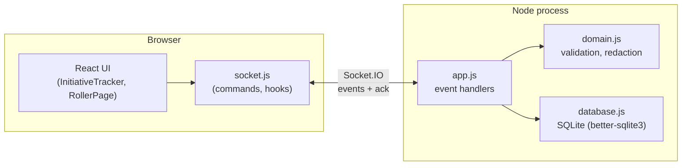
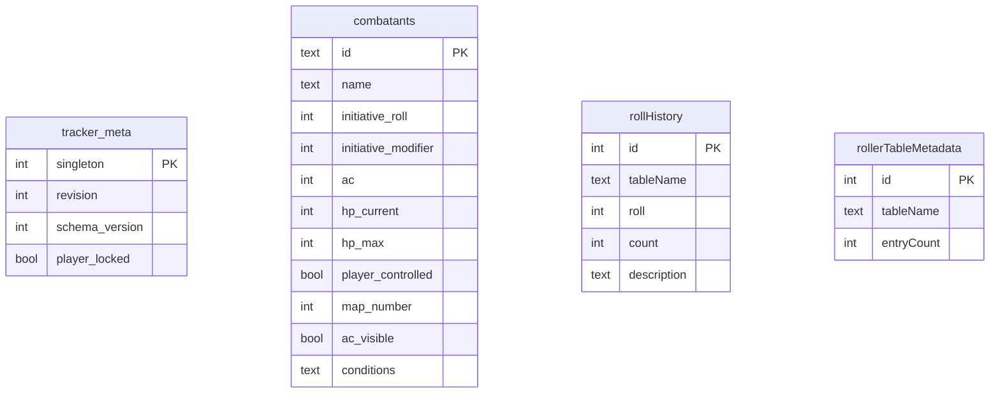

# Architecture

A React client and an Express/Socket.IO server, talking over one WebSocket connection. The server owns all state; SQLite is the only durable store.

## Big picture

- **One connection, one source of truth.** The client never computes combat state; it sends commands and renders whatever snapshot the server pushes back.
- **Every mutation follows the same path:** validate in `domain.js` → write in one SQLite transaction → broadcast a fresh snapshot to everyone, redacted per viewer (players don't see hidden enemy stats).
- **DM login** mints a random token held in memory on the server (`Map` of token → last-used time) and in the browser's `sessionStorage`. No DB row, no JWT — restarting the server logs every DM out.
- **Static files**: in production, the same Node process also serves the built client and `/api/health`; there's no separate API origin.

## Data

- `tracker_meta` is a single row (`singleton = 1`): the current revision number and the player-editing lock.
- `combatants` is the whole encounter. `player_controlled` decides who may edit a row; `map_number` is a stable label assigned only to enemies.
- Roller tables (`rollerTableMetadata` + one generated table per `.txt` file in `server/data/`) and `rollHistory` are a separate feature (the dice-roller page) and don't reference `combatants`.

Nothing else: no foreign keys between these tables, no joins across them at read time — each snapshot read is a flat `SELECT * FROM combatants`.
