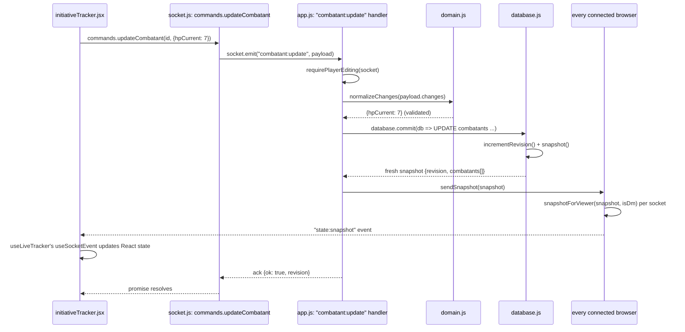
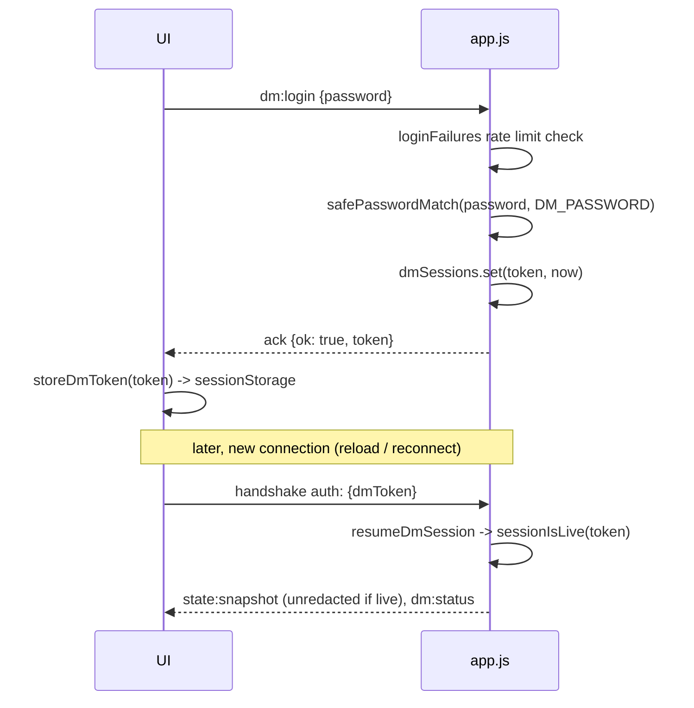

# Data flow

How a change actually moves through the code, function by function. Pairs with `docs/ARCHITECTURE.md` (the component-level picture) — this one is the wiring.

## The canonical path (any mutation)

Every write — add/edit/remove a combatant, toggle a condition, lock players, reroll initiative — follows the exact same chain. Editing a combatant's HP, end to end:

Two things never skip a step:

- **Validation always happens before persistence.** `app.js` never writes a raw payload; it always passes through a `domain.js` function first (`normalizeChanges`, `normalizeCombatant`, `normalizeConditionName`, `applyConditionToggle`...). `domain.js` does no I/O, so these are the only functions worth unit-testing for correctness.
- **The broadcast is unconditional and global.** `sendSnapshot` loops every socket in `io.sockets.sockets`, not just the one that sent the command — that's how two browsers stay in sync. Each socket gets its own redaction via `snapshotForViewer`, computed fresh per recipient (so a DM who just logged out mid-broadcast still gets the redacted view).

## Who calls what

| UI calls (`commands.*`) | Socket event | Server handler logic | domain.js functions used | database.js functions used |
|---|---|---|---|---|
| `addCombatant` | `combatant:add` | `requirePlayerEditing`, assigns map number if DM-added | `normalizeCombatant` | `nextMapNumber` (via `lowestAvailableMapNumber`), `commit` |
| `updateCombatant` | `combatant:update` | `requirePlayerEditing`, ownership check (player can only edit own) | `normalizeChanges` | `commit` |
| `setCombatantCondition` | `combatant:set-condition` | `requirePlayerEditing`, ownership check | `normalizeConditionName`, `parseConditions`, `applyConditionToggle` | `commit` |
| `setCombatantControl` | `combatant:set-player-controlled` | DM-only | — | `nextMapNumber`, `commit` |
| `setCombatantAcVisible` | `combatant:set-ac-visible` | DM-only | — | `commit` |
| `setAllEnemyAcVisible` | `combatants:set-enemy-ac-visible` | DM-only, bulk | — | `commit` |
| `rerollAllInitiative` | `combatants:reroll-initiative` | DM-only, bulk (one transaction, not N) | `normalizeChanges` (per roll) | `commit` |
| `setPlayerLocked` | `tracker:set-player-locked` | DM-only, flips the lock `requirePlayerEditing` reads | — | `commit` |
| `removeCombatant` | `combatant:remove` | DM-only | — | `commit` |
| `clearCombat` | `combat:clear` | DM-only, wipes all combatants | — | `commit` |
| `loginDm` | `dm:login` | checks `loginFailures` rate limit, `safePasswordMatch` | — | — (session is in-memory `dmSessions`, not the DB) |
| `resumeDm` | `dm:resume` | `resumeDmSession` → `sessionIsLive` | — | — |
| `logoutDm` | `dm:logout` | deletes token from `dmSessions` | — | — |
| `requestState` | `state:request` | — | — | `snapshot` |
| `listTables` | `tables:list` | — | — | `listRollerTables` |
| `rollOnTable` | `tables:roll` | rate limit via `socket.data.lastRollAt` | — | `rollOnTable`, `recordRoll` |
| `rollHistory` | `tables:history` | DM-only | — | `listRollHistory` |

Every row except the DM auth ones and the roller-table ones ends in `sendSnapshot` (broadcast) after `commit`. `tables:roll` additionally calls `sendRollHistory` (pushed to DM sockets only).

## How the client receives it back

`src/helpers/socket.js` is the only file that touches `socket.io-client` directly — routes never call `socket.on`/`socket.emit` themselves.

- `commands.*` — fire-and-await a mutation, resolve with its ack (`{ok, ...}` or `{ok: false, error}`).
- `useSocketEvent(event, initial, reduce)` — generic subscribe-to-a-push hook. Everything below is built on it.
- `useDmStatus()` — tracks `"dm:status"` pushes; used by pages that only need to know DM-or-not (e.g. `rollerPage.jsx`).
- `useLiveTracker()` — the one hook `initiativeTracker.jsx` uses for everything: wires `useConnected` + `useSocketEvent("state:snapshot", ...)` + `useSocketEvent("dm:status", ...)` together, and on every `connect` event re-sends `resumeDm` (if a token is stored) and `requestState` (to catch up on anything missed while disconnected).

So the full receive-side chain for a snapshot push is: `socket.on("state:snapshot")` (registered inside `useSocketEvent`) → its `reduce` function (drops the push if `revision` is stale) → `setValue` → React re-render of `initiativeTracker.jsx`.

## DM auth, as its own mini-flow

`isDm(socket)` is checked fresh on *every* handler call (it's a function, not a cached flag) — so a token expiring mid-session takes effect on the next command, not just the next connection.
